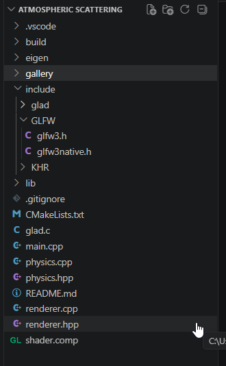

So you must have 

[Eigen](https://libeigen.gitlab.io/)
include/[Glad.h](https://glad.dav1d.de/) (generate on 4.3+ opengl)
include/[Khr] you get this with glad
include/[GLFW](https://www.glfw.org/) downlaod whichever suitable version
glad.c -- in same directory as main

